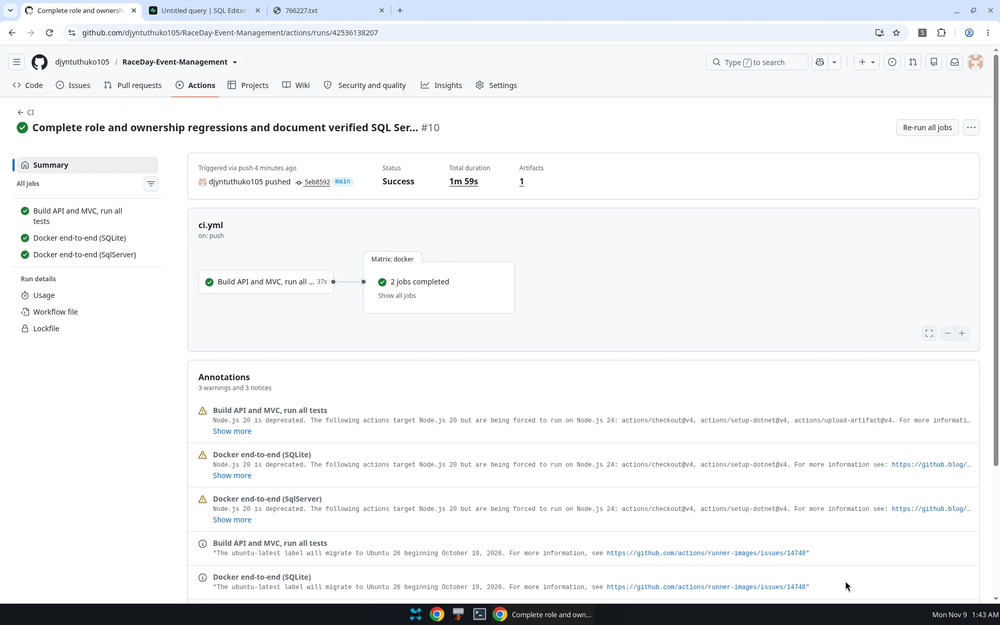

<div align="center">

# RaceDay

**Event management for South African running, walking and cycling events**


**Author:** ST10444612 Mike Thando Ndaba

</div>

---

## Table of Contents

- [Overview](#overview)
- [Features](#features)
- [Prerequisites](#prerequisites)
- [Getting Started](#getting-started)
  - [Option 1: SQL Server stack (required)](#option-1-sql-server-stack-required)
  - [Option 2: Lightweight SQLite demo](#option-2-lightweight-sqlite-demo)
  - [Option 3: Run locally without Docker](#option-3-run-locally-without-docker)
- [Demo Accounts](#demo-accounts)
- [Azure Blob Configuration](#azure-blob-configuration)
- [Build and Verify](#build-and-verify)
- [Project Structure](#project-structure)
- [Behaviour and CI](#behaviour-and-ci)

---

## Overview

RaceDay is a responsive ASP.NET Core MVC platform for South African running, walking and cycling events. The website consumes the Part 2 REST API for all data operations. Database access, authentication rules and Azure Blob uploads remain in the API.

## Features

### Organisers

- Ownership-scoped dashboard
- Event and venue management
- Age and distance categories
- Banner uploads
- Enrolment lists
- Post-race result entry

### Participants

- Filter upcoming events
- Enter a category and manage entries
- View personal results
- Edit profile and upload a profile picture

### Interface

- Role-specific navigation
- Accessible forms
- Responsive cards and tables
- Clearly labelled, colour-coded entry statuses
- Current weather from [Open-Meteo](https://open-meteo.com/) and directions to the venue on event pages (directions are not the official race course)

## Prerequisites

| Requirement | Purpose |
| --- | --- |
| .NET 8 SDK | Local development and testing |
| Docker Engine or Desktop with Compose v2 | Complete containerised demo |
| SQL Server 2022 | Required database stack (a separate portable demo uses SQLite) |
| Azure storage connection string | Only needed when testing against a real Azure account. The Docker demo uses the free local Azurite emulator |

## Getting Started

### Option 1: SQL Server stack (required)

Set a strong, disposable `SQL_PASSWORD` environment variable in your shell, then run:

```bash
docker compose -f compose.yml -f compose.sqlserver.yml up --build -d
```

This starts SQL Server Developer, applies the original EF Core migration to a fresh `RaceDayDB`, seeds the demo accounts and starts MVC, API and Azurite.

> **Note:** SQL Server needs compatible x64 hardware, sufficient memory and acceptance of Microsoft's development licence. Never enable demo seeding against a live database.

Stop the stack with the command below. Data volumes are retained.

```bash
docker compose -f compose.yml -f compose.sqlserver.yml down
```

### Option 2: Lightweight SQLite demo

From the repository root:

```bash
docker compose up --build -d
```

| Service | Address |
| --- | --- |
| MVC website | http://localhost:5000 |
| API Swagger | http://localhost:5080/swagger |
| API readiness | http://localhost:5080/health |

Compose builds separate, non-root API and MVC images and starts persistent SQLite and Azurite storage. No paid resources are created. The emulator key in Compose is intentionally public and local-only.

```bash
docker compose logs -f
docker compose down
```

Stopping the stack preserves its data volumes. Both application images use Africa/Johannesburg time. The demo binds host ports to loopback and is not a production deployment.

#### Running the MVC image separately

To run the MVC image against the existing Compose API:

```bash
docker build --target web -t raceday-web .
docker run --rm -p 5001:8080 --network raceday-part3_default -e Api__BaseUrl=http://api:8080/ raceday-web
```

Open http://localhost:5001. The Compose API must already be running.

### Option 3: Run locally without Docker

In separate terminals from the repository root:

```bash
dotnet restore RaceDay-Event-Management.sln
dotnet run --project RaceDay-Event-Management.API --no-launch-profile -- --environment LocalDemo --urls http://localhost:5080
dotnet run --project RaceDay-Event-Management.Web --no-launch-profile -- --urls http://localhost:5000
```

The `LocalDemo` environment creates a local SQLite database and enables sample data. It explicitly uses **local file storage**, not Azure Blob Storage. SQL Server remains the default provider outside this selected demo. The original Visual Studio launch profiles are retained.

#### Using your own SQL Server

- Supply `ConnectionStrings__RaceDayDb`.
- Set `Database__Provider=SqlServer` and omit `LocalDemo`.
- Set `Database__SeedDemo=true` only for a fresh, disposable database.
- Do not run the Part 1 SQL script on top of an EF-created database. Use a separate planning database or instance.

## Demo Accounts

Every seeded account uses the password `Password123!`. These are disposable coursework examples.

| Email | Role |
| --- | --- |
| thabo@raceday.co.za | Organiser |
| naledi@raceday.co.za | Organiser |
| kabelo@example.com | Participant |
| lerato@example.com | Participant |

You can also register through the website. Role self-selection is intentional for this coursework. A public service would need organiser approval.

## Azure Blob Configuration

Set these environment variables on the **API process only**:

| Variable | Value |
| --- | --- |
| `Storage__Provider` | `AzureBlob` |
| `Storage__ConnectionString` | Your securely supplied storage connection string |
| `Storage__Container` | `raceday-images` |

Uploads follow the flow **MVC → API → Blob Storage**. The API stores the actual image URL in the database and serves images from the private container through API content endpoints. MVC does not access Azure credentials or the database.

### Upload rules

- JPG, PNG, GIF and WebP files are accepted, limited to 5 MB and checked for matching signatures.
- SVG files are rejected.
- Filenames are generated by the API, and profile updates cannot inject arbitrary image URLs.
- Replaced profile images are retained for later lifecycle cleanup.
- Never commit keys, connection strings or `.env` files.

### Emulator versus live Azure

The default Docker stack uses the Azure SDK against Azurite. Emulator verification is not evidence of a live Azure account upload. Live Azure setup was deliberately skipped, and the demo and CI retain Azurite.

## Build and Verify

```bash
dotnet build RaceDay-Event-Management.sln -c Release
dotnet test RaceDay-Event-Management.sln -c Release
```

There are 50 API, weather and MVC integration tests covering authentication, roles, ownership, event and category management, entries, results, profile images and error states.

### Smoke checks

With the Blob-enabled demo stack running:

```bash
dotnet run --project RaceDay-Event-Management.SmokeChecks -c Release
```

This native C# check uses only .NET libraries and only targets loopback services. It waits for local services and verifies:

- Real registration and login, and role rejection
- Event creation, category entry and organiser enrolments
- Post-race results and finisher counts
- Blob banner and profile uploads, persisted URLs and image bytes
- Logout
- Creation, update and deletion of an empty event

Completed-race fixtures remain for inspection. CI removes its disposable volumes afterwards.

## Project Structure

```text
RaceDay-Event-Management.API/          REST API, EF Core, sessions and storage
RaceDay-Event-Management.Web/          MVC, Razor views, API client and styling
RaceDay-Event-Management.API.Tests/    API and weather tests
RaceDay-Event-Management.Web.Tests/    Complete MVC/API workflow tests
RaceDay-Event-Management.SmokeChecks/  Native C# local-stack verification
docs/                                  Original planning files and coverage notes
Dockerfile                             Separate API and MVC runtime targets
compose.yml                            SQLite/Azurite demo stack
compose.sqlserver.yml                  Required SQL Server stack overlay
```

The original ERD, endpoint plan, SQL script, migrations and earlier submission notes are preserved. MVC links only request and response DTOs, and it has no EF Core or Azure SDK reference.

### Schema notes

- The historical ERD labels use `NVARCHAR` and `DATETIME2`, while the SQL script and EF mapping deliberately use `VARCHAR` and `DATETIME`.
- EF also requires timestamps where the planning script permits nulls.
- The nine entities and their relationships are retained. Do not treat these historical type and nullability differences as an exact byte-for-byte schema match.

## Behaviour and CI

### Application behaviour

- API rules enforce ownership, registration deadlines, duplicate-entry checks and capacity limits.
- Results open after the event date and show finish times, overall positions and the count of recorded finishers, not an invented final field size.
- Weather has bounded requests, caching and an honest unavailable state. It is current weather, not a forecast for a distant race date.
- Each MVC session stores its own API cookie, user ID and role. Logout clears both sessions.
- In-memory sessions end when applications restart. Multi-instance hosting needs shared session storage.
- A real deployment requires HTTPS, secure secrets and appropriate access management.

### Continuous integration

[GitHub Actions](https://github.com/djyntuthuko105/RaceDay-Event-Management/actions) builds both applications and runs all tests. The Docker matrix exercises **both SQL Server and SQLite**, each with API, MVC and Azurite. CI generates and masks its SQL Server password, and no cloud account or paid infrastructure is provisioned. It also runs the preserved Part 1 SQL script in a separate disposable database.

[Verified Part 3 run 42536138207](https://github.com/djyntuthuko105/RaceDay-Event-Management/actions/runs/42536138207) passed:

- All 50 tests
- Both SQL Server and SQLite Docker stacks
- The full race and Blob smoke workflow
- Fresh EF migrations
- Nine-table and demo-seed assertions
- The original planning script

The screenshot below records that successful run for [commit `5eb8592`](https://github.com/djyntuthuko105/RaceDay-Event-Management/commit/5eb8592df739398d425a0047c185bc7e2b84582a). It does not claim to show later documentation-only commits, so check Actions for their actual status.

[](https://github.com/djyntuthuko105/RaceDay-Event-Management/actions/runs/42536138207)

The earlier planning-stage screenshot remains preserved in [the Part 1/2 notes](docs/part1-part2-readme.md).
