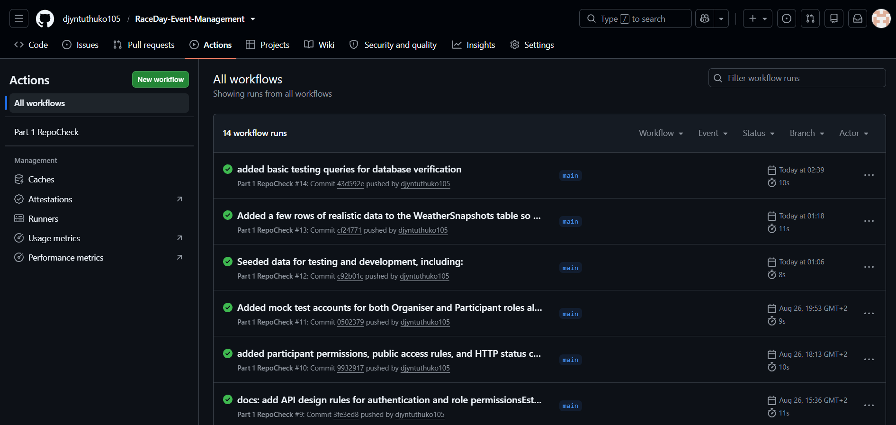

# RaceDay

A responsive ASP.NET Core MVC platform for South African running, walking and cycling events. The website consumes the Part 2 REST API for all data operations; database access, authentication rules and Azure Blob uploads remain in the API.

## Features

**Organisers** have an ownership-scoped dashboard, event and venue management, age/distance categories, banner uploads, enrolment lists and post-race result entry.

**Participants** can filter upcoming events, enter a category, manage their entries, view personal results, edit their profile and upload a profile picture.

The interface includes role-specific navigation, accessible forms, responsive cards and tables, and clearly labelled, colour-coded entry statuses. Event details also show current weather from [Open-Meteo](https://open-meteo.com/) and directions to the venue—not the official race course.

## Prerequisites

- .NET 8 SDK for local development and testing.
- Docker Engine/Desktop with Compose v2 for the complete containerised demo.
- SQL Server 2022 for the required database stack; a separate portable demo uses SQLite.
- An Azure storage connection string only when testing against a real Azure account. The Docker demo uses the free local Azurite emulator.

## Run the required SQL Server stack

Set a strong, disposable `SQL_PASSWORD` environment variable in your shell, then run:

```bash
docker compose -f compose.yml -f compose.sqlserver.yml up --build -d
```

This starts SQL Server Developer, applies the original EF Core migration to a fresh `RaceDayDB`, seeds the demo accounts and starts MVC, API and Azurite. SQL Server needs compatible x64 hardware, sufficient memory and acceptance of Microsoft's development licence. Never enable demo seeding against a live database.

The addresses are listed below. Stop this stack with `docker compose -f compose.yml -f compose.sqlserver.yml down`; data volumes are retained.

## Run the lightweight SQLite demo

From the repository root:

```bash
docker compose up --build -d
```

| Service | Address |
| --- | --- |
| MVC website | http://localhost:5000 |
| API Swagger | http://localhost:5080/swagger |
| API readiness | http://localhost:5080/health |

Compose builds separate, non-root API and MVC images and starts persistent SQLite and Azurite storage. No paid resources are created. The emulator key in Compose is intentionally public and local-only.

```bash
docker compose logs -f
docker compose down
```

Stopping the stack preserves its data volumes. Both application images use Africa/Johannesburg time. The demo binds host ports to loopback and is not a production deployment.

To run the MVC image separately against the existing Compose API:

```bash
docker build --target web -t raceday-web .
docker run --rm -p 5001:8080 --network raceday-part3_default -e Api__BaseUrl=http://api:8080/ raceday-web
```

Open http://localhost:5001. The Compose API must already be running.

## Run locally without Docker

In separate terminals from the repository root:

```bash
dotnet restore RaceDay-Event-Management.sln
dotnet run --project RaceDay-Event-Management.API --no-launch-profile -- --environment LocalDemo --urls http://localhost:5080
dotnet run --project RaceDay-Event-Management.Web --no-launch-profile -- --urls http://localhost:5000
```

`LocalDemo` creates a local SQLite database and enables sample data. It explicitly uses **local file storage**, not Azure Blob Storage. SQL Server remains the default provider outside this selected demo. Original Visual Studio launch profiles are retained.

For your own development SQL Server, supply `ConnectionStrings__RaceDayDb`, use `Database__Provider=SqlServer` and omit `LocalDemo`. Set `Database__SeedDemo=true` only for a fresh disposable database. Do not run the Part 1 SQL script on top of an EF-created database; use a separate planning database/instance.

### Demo accounts

Every seeded account uses `Password123!`. These are disposable coursework examples.

| Email | Role |
| --- | --- |
| thabo@raceday.co.za | Organiser |
| naledi@raceday.co.za | Organiser |
| kabelo@example.com | Participant |
| lerato@example.com | Participant |

You can also register through the website. Role self-selection is intentional for this coursework; a public service would need organiser approval.

## Azure Blob configuration

Set these environment variables on the **API process only**:

| Variable | Value |
| --- | --- |
| `Storage__Provider` | `AzureBlob` |
| `Storage__ConnectionString` | Your securely supplied storage connection string |
| `Storage__Container` | `raceday-images` |

Uploads follow **MVC → API → Blob Storage**. The API stores the actual image URL in the database and serves images from the private container through API content endpoints. MVC does not access Azure credentials or the database.

JPG, PNG, GIF and WebP files are limited to 5 MB and checked for matching signatures. SVG files are rejected. Filenames are generated by the API, and profile updates cannot inject arbitrary image URLs. Replaced profile images are retained for later lifecycle cleanup. Do not commit keys, connection strings or `.env` files.

The default Docker stack uses the Azure SDK against Azurite. Emulator verification is not evidence of a live Azure account upload.

## Build and verify

```bash
dotnet build RaceDay-Event-Management.sln -c Release
dotnet test RaceDay-Event-Management.sln -c Release
```

There are 50 API/weather and MVC integration tests covering authentication, roles, ownership, event/category management, entries, results, profile images and error states.

With the Blob-enabled demo stack running:

```bash
dotnet run --project RaceDay-Event-Management.SmokeChecks -c Release
```

This native C# check uses only .NET libraries. It waits for local services and verifies real registration/login, role rejection, event creation, category entry, organiser enrolments, post-race results, finisher counts, Blob banner/profile uploads, persisted URLs, image bytes and logout. It also creates, updates and deletes an empty event. Completed-race fixtures remain for inspection; CI removes its disposable volumes afterwards. It only targets loopback services.

## Project structure

```text
RaceDay-Event-Management.API/          REST API, EF Core, sessions and storage
RaceDay-Event-Management.Web/          MVC, Razor views, API client and styling
RaceDay-Event-Management.API.Tests/    API and weather tests
RaceDay-Event-Management.Web.Tests/    Complete MVC/API workflow tests
RaceDay-Event-Management.SmokeChecks/  Native C# local-stack verification
docs/                                Original planning files and coverage notes
Dockerfile                           Separate API and MVC runtime targets
compose.yml                          SQLite/Azurite demo stack
compose.sqlserver.yml                Required SQL Server stack overlay
```

The original ERD, endpoint plan, SQL script, migrations and earlier submission notes are preserved. MVC links only request/response DTOs; it has no EF Core or Azure SDK reference. The historical ERD labels use `NVARCHAR`/`DATETIME2`; the SQL script and EF mapping deliberately use `VARCHAR`/`DATETIME`. EF also requires timestamps where the planning script permits nulls. The nine entities and their relationships are retained; do not treat these historical type/nullability differences as an exact byte-for-byte schema match.

## Behaviour and CI

- API rules enforce ownership, registration deadlines, duplicate-entry checks and capacity limits.
- Results open after the event date and show finish times, overall positions and the count of recorded finishers—not an invented final field size.
- Weather has bounded requests, caching and an honest unavailable state. It is current weather, not a forecast for a distant race date.
- Each MVC session stores its own API cookie, user ID and role. Logout clears both sessions. In-memory sessions end when applications restart; multi-instance hosting needs shared session storage.
- Real deployment requires HTTPS, secure secrets and appropriate access management.

[GitHub Actions](https://github.com/djyntuthuko105/RaceDay-Event-Management/actions) builds both applications and runs all tests. The Docker matrix exercises **both SQL Server and SQLite**, each with API, MVC and Azurite. CI generates and masks its SQL Server password; no cloud account or paid infrastructure is provisioned. It also runs the preserved Part 1 SQL script in a separate disposable database.

[Verified SQL Server/SQLite container run](https://github.com/djyntuthuko105/RaceDay-Event-Management/actions/runs/42535805542) passed the full race/Blob smoke workflow, fresh EF migrations, nine-table/demo-seed assertions and the original planning script. Check Actions for subsequent commits' actual status.

The genuine earlier **Part 1 RepoCheck** screenshot is preserved below; it is not presented as a screenshot of the newer Part 3 jobs.



## Credits

Original RaceDay artwork and styling are bundled locally. Bootstrap 5.3.3 is included under the MIT licence with its original CSS notice. Weather data is provided by Open-Meteo under CC BY 4.0. Repository owner: `djyntuthuko105`.
